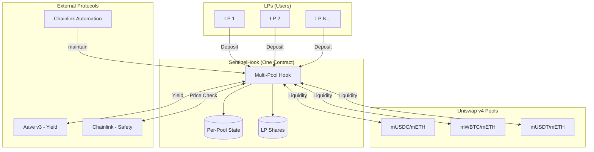

# 🛡️ Sentinel Liquidity Protocol

**Trust-Minimized Agentic Liquidity Management as a Service for Uniswap v4** 
  
**SentinelHook (Sepolia):** [0xA7F23aFF760f6e34E823Bbf529fE3Fa54C93A080](https://sepolia.etherscan.io/address/0xA7F23aFF760f6e34E823Bbf529fE3Fa54C93A080#code)
TxId transactions can be seen on the above address on Etherscan. clicking the above addesses will show the transactions on Etherscan. 

---   


  
## 💡 The Problem

Traditional liquidity provision on Uniswap requires constant monitoring and rebalancing. LPs face:
- **Impermanent Loss:** Price movements outside their range mean zero fee income
- **Active Management:** Manual rebalancing is time-consuming and gas-intensive
- **Idle Capital:** Out-of-range liquidity earns nothing
- **Trust Issues:** Existing "LP management" solutions require trusting a centralized bot 


## 🎯 The Solution

**Sentinel Liquidity Protocol** is a **Liquidity Management as a Service (LMaaS)** platform built on Uniswap v4 Hooks. LPs deposit tokens, receive shares, and Sentinel autonomously manages their positions across **any supported pool**.

### Key Innovation

| Problem | Sentinel Solution |
|---------|-------------------|
| **Trust** | Hybrid architecture: Immutable Hook (safety) + Chainlink Automation/Functions (execution) |
| **Idle Capital** | Automatic routing to Aave v3 for lending yield |
| **Multi-Pool** | Single hook contract serves unlimited pools |
| **Gas Efficiency** | Shared infrastructure reduces per-LP costs |

---

## 🏗️ Architecture Overview



### Two-Path Design

#### 🔥 Hot Path (Every Swap)
- **Trigger:** `beforeSwap` hook on all pools using Sentinel
- **Gas Budget:** < 50,000 gas
- **Logic:** Oracle price deviation check (circuit breaker)
- **Output:** TickCrossed event if price moved outside range

#### ❄️ Cold Path (Chainlink Automation)
- **Trigger:** TickCrossed event or scheduled interval
- **Executor:** Chainlink Automation (Functions optional for off-chain strategy)
- **Logic:** Calculate optimal range and Active/Idle split off-chain, then execute `maintain()`
- **Output:** `maintain()` transaction to rebalance

---

## 🔄 Asset Flow

### LP Deposit Flow
```
1. LP approves tokens
2. LP calls depositLiquidity(poolId, amount0, amount1)
3. Hook calculates shares based on NAV
4. LP receives shares, tokens held by Hook
5. Next maintain() deploys tokens to pool + Aave
```

### Rebalancing Flow
```
1. Price moves outside active range
2. beforeSwap emits TickCrossed event
3. Chainlink Automation detects event (or cron)
4. Strategy computes optimal new range
5. Chainlink Automation calls maintain(poolId, newRange, volatility)
7. Hook: Withdraw old range → Calculate split → Deploy new range + Aave
```

### LP Withdrawal Flow
```
1. LP calls withdrawLiquidity(poolId, shares)
2. Hook calculates proportional claim
3. Withdraw from Aave (if needed)
4. Withdraw from pool (proportional liquidity)
5. Transfer tokens to LP, burn shares
```

---

## 📂 Project Structure

```
sentinel-protocol/
├── src/                           # Smart Contracts
│   ├── SentinelHook.sol          # Multi-pool hook (main contract)
│   ├── libraries/
│   │   ├── OracleLib.sol         # Price deviation checks
│   │   ├── YieldRouter.sol       # Active/Idle split calculations
│   │   └── AaveAdapter.sol       # Aave v3 integration
│   └── automation/
│       ├── SentinelAutomation.sol # Chainlink Automation + Functions
│       └── functions/
│           └── rebalancer.js     # Off-chain strategy computation
│
├── test/                          # Foundry Tests (81 passing)
│   ├── unit/                     # SentinelHookUnit, OracleLib, YieldRouter, AaveAdapter
│   ├── fuzz/                     # Fuzz + invariant testing
│   ├── integration/              # Multi-pool lifecycle tests
│   └── mocks/                    # MockERC20, MockAavePool, MockOracle, etc.
│
├── script/                        # Deployment Scripts
│   ├── DeployAll.s.sol           # Full demo deploy (mocks + pools + seeds + JSON)
│   ├── DeploySentinel.s.sol      # Production-style deploy
│   ├── DeployAutomationFull.s.sol # All-in-one automation deploy + pool registration
│   ├── DeploySentinelAutomation.s.sol # Automation contract deploy (standalone)
│
│
├── frontend/                      # React Frontend (Vite + wagmi + shadcn/ui)
│   └── src/
│       ├── pages/                # Dashboard, Pools, Positions, Automation, Faucet
│       ├── components/           # Deposit/Withdraw/Mint dialogs, Sidebar
│       ├── hooks/                # use-sentinel.ts, use-tokens.ts
│       └── lib/                  # addresses.ts, abi.ts, wagmi.ts
│
├── workflows/                     # Chainlink Automation
│   └── sentinel-workflow.yaml    # Workflow spec (Chainlink)
│
├── docs/                          # Documentation
│   ├── chainlink_automate.md     # Chainlink Automation reference
│   ├── whitepaper.md             # Protocol whitepaper
│   ├── reactive_strategy.md      # Rebalancing strategy details
│   └── tech_stack.md             # Technology details
│
├── agents.md                      # AI Agent context (START HERE)
├── VISUAL_GUIDE.md               # Diagrams and flows
└── README.md                      # This file
```

---

## 🚀 Getting Started

### Prerequisites
- [Foundry](https://book.getfoundry.sh/getting-started/installation) (`forge`, `cast`, `anvil`)
- Node.js 18+ (for frontend)
- Sepolia RPC URL (Alchemy/Infura)

### Installation

```bash
# Clone the repository
git clone https://github.com/your-org/sentinel-protocol.git
cd sentinel-protocol

# Install dependencies
forge install

# Build contracts
forge build
```

### Running Tests

```bash
# Unit + fuzz tests
forge test --match-path "test/unit/*.t.sol"
forge test --match-path "test/fuzz/*.t.sol"

# Integration tests (fork)
forge test --match-path "test/integration/*.t.sol" --fork-url $SEPOLIA_RPC_URL -vvv

# Gas report
forge test --gas-report
```

### Deployment

```bash
# MAIN: Full demo deploy (mock tokens, mock Aave, pools, seeds) on Sepolia
forge script script/DeployAll.s.sol --account test1 --rpc-url $SEPOLIA_RPC_URL --broadcast -vvv

# Verify on Etherscan
forge verify-contract <ADDRESS> SentinelHook --chain sepolia
```

For deterministic demos, set `USE_MOCK_FEEDS=true` before running DeployAll.
DeployAll also writes `deployment.json`; run `node update_addresses.js` to sync the frontend.

Optional env var for hook deployment:

- `CHAINLINK_MAINTAINER` (sets the initial `maintainer`; defaults to deployer)

### Automation (Chainlink Automation)

```bash
# Deploy SentinelAutomation + register pools + set maintainer (all-in-one)
forge script script/DeployAutomationFull.s.sol --account test1 --rpc-url $SEPOLIA_RPC_URL --broadcast -vvv
```

Required env vars for automation (in `.env`):

- `SEPOLIA_RPC_URL` — Alchemy/Infura Sepolia endpoint
- `DEPLOYMENT_JSON` (optional — defaults to `deployment.json` from `DeployAll`)

Post-deploy Chainlink UI steps:
1. **Register Automation Upkeep** at [automation.chain.link](https://automation.chain.link/) → Custom Logic → paste SentinelAutomation address → fund with LINK

---

## 🌐 Deployed Contracts (Sepolia Testnet)

All contracts are **deployed and verified** on Sepolia. View on [Etherscan](https://sepolia.etherscan.io).

### Core Contracts

| Contract | Address | Status |
|----------|---------|--------|
| **Uniswap PoolManager** | [`0x8C4BcBE6b9eF47855f97E675296FA3F6fafa5F1A`](https://sepolia.etherscan.io/address/0x8C4BcBE6b9eF47855f97E675296FA3F6fafa5F1A) | Canonical |
| **SentinelHook** | [`0xA7F23aFF760f6e34E823Bbf529fE3Fa54C93A080`](https://sepolia.etherscan.io/address/0xA7F23aFF760f6e34E823Bbf529fE3Fa54C93A080#code) | ✅ Verified |
| **SwapHelper** | [`0x0ce1552c2146D730e220aB7e9137249e0E651177`](https://sepolia.etherscan.io/address/0x0ce1552c2146D730e220aB7e9137249e0E651177#code) | ✅ Verified |
| **SentinelAutomation** | [`0x24A79d2c74dEe4caff80aBEc21cA1C8bbD15135c`](https://sepolia.etherscan.io/address/0x24A79d2c74dEe4caff80aBEc21cA1C8bbD15135c) | Automation (Sepolia) |
| **MockAave (manager)** | [`0xF8d4681bbFd7946B2f65FE2B7c4Fe043495D40b2`](https://sepolia.etherscan.io/address/0xF8d4681bbFd7946B2f65FE2B7c4Fe043495D40b2) | Deployed |

### Mock Tokens

| Token | Address |
|-------|--------|
| **mETH** (Mock WETH) | [`0x0e36C47a2cCf406ee12fac225D3Dd3Da465B859c`](https://sepolia.etherscan.io/address/0x0e36C47a2cCf406ee12fac225D3Dd3Da465B859c) |
| **mUSDC** | [`0x69810Addf24E88fbfc39Cd207f9EE794E3f7Ba33`](https://sepolia.etherscan.io/address/0x69810Addf24E88fbfc39Cd207f9EE794E3f7Ba33) |
| **mWBTC** | [`0x4cF23E8f91b86ee28A483d4ed28A6d8e2f3f7FaC`](https://sepolia.etherscan.io/address/0x4cF23E8f91b86ee28A483d4ed28A6d8e2f3f7FaC) |
| **mUSDT** | [`0x001Aa5ae632aF10e4bf068D17be11ee984a3B400`](https://sepolia.etherscan.io/address/0x001Aa5ae632aF10e4bf068D17be11ee984a3B400) |

### Aave aTokens (Mock)

| aToken | Address | Underlying |
|--------|---------|------------|
| **maETH** | `0xE7F85Ee92dd51bbAB76700DF0198C366c2F9D07B` | mETH |
| **maUSDC** | `0x2b9a68fa35bb2F6f88E90FB68265315B9dc8fb03` | mUSDC |
| **maWBTC** | `0x049Ad2fc1b7d105C6c7502Cd1E1EF8af74c59139` | mWBTC |
| **maUSDT** | `0x4197Aa46167911C3Ed87d023C0B704e597be8989` | mUSDT |

### Deployed Pools (3 Active)

| Pool | Pool ID | Oracle |
|------|---------|--------|
| **mUSDC/mETH** | `0xd81e2f7075ef839ab7897b6609296cb71b4b951bab1215cff428e8e58d6d9c86` | ETH/USD |
| **mWBTC/mETH** | `0xedaee9b731b3f6b66651873d25251d4164f053f6338e20cad90121735c7c25a1` | BTC/ETH (Ratio) |
| **mUSDT/mETH** | `0x6c92e8eeb40fe91f771ca88bd635f4df6124ddf26602b17b58dc78c35d821890` | ETH/USD |

### Chainlink Integration

| Component | Details |
|-----------|--------|
| **Automation Upkeep** | Register via automation.chain.link |
| **Functions Subscription** | Not used |
| **DON ID** | Not used |
| **Functions Router** | Not used |

### Chainlink Oracles (Real Sepolia Feeds)

| Feed | Address |
|------|---------|
| ETH/USD | `0x694AA1769357215DE4FAC081bf1f309aDC325306` |
| BTC/USD | `0x1b44F3514812d835EB1BDB0acB33d3fA3351Ee43` |
| USDC/USD | `0xA2F78ab2355fe2f984D808B5CeE7FD0A93D5270E` |
| BTC/ETH (Ratio) | `0xc596b108197aEF64c6d349DcA8515dFFe4615502` |

---

## 🔌 Supported Pools

Sentinel can manage ANY Uniswap v4 pool that:
1. ✅ Has the SentinelHook attached at initialization
2. ✅ Has at least one token supported by Aave v3
3. ✅ Has a corresponding Chainlink price feed

### Example Configurations

| Pool | aToken0 Yield | aToken1 Yield | Oracle | Risk Profile |
|------|---------------|---------------|--------|--------------|
| ETH/USDC | aWETH | aUSDC | ETH/USD | Blue chip |
| WBTC/ETH | aWBTC | aWETH | BTC/ETH | High volatility |
| ARB/USDC | — (disabled) | aUSDC | ARB/USD | L2 native |
| stETH/ETH | aStETH | aWETH | stETH/ETH | LST arbitrage |

---

## 🛡️ Security Model

### Trust Hierarchy

```
┌─────────────────────────────────────────────────────────────┐
│ Level 1: Smart Contract (Immutable)                        │
│ ├── Oracle deviation checks (circuit breaker)              │
│ ├── LP share accounting (proportional claims only)         │
│ └── Range validation (min/max bounds)                      │
├─────────────────────────────────────────────────────────────┤
│ Level 2: Chainlink Automation (Execution)                  │
│ ├── Whitelisted executor (automation contract)             │
│ ├── Event/cron driven execution                             │
│ └── No custody of LP funds                                  │
├─────────────────────────────────────────────────────────────┤
│ Level 3: Strategy Parameters (Configurable)                │
│ ├── Volatility thresholds                                  │
│ ├── Range width bounds                                     │
│ └── Yield protocol selection                               │
└─────────────────────────────────────────────────────────────┘
```

### What automation CAN'T Do
- ❌ Withdraw LP funds (only LPs can withdraw their shares)
- ❌ Bypass oracle checks (enforced in immutable Hook code)
- ❌ Set invalid ranges (Hook validates all parameters)
- ❌ Bypass the `maintainer` gate (only the configured executor can call `maintain()`)

---

## 🏆 Hackathon Track: Agentic Finance

This project addresses the track criteria by:

| Criterion | Implementation |
|-----------|----------------|
| **Reliability** | Hook acts as hard "circuit breaker" - agents can't drain funds |
| **Composability** | Deep Uniswap v4 + Aave v3 + Chainlink integration |
| **Decentralization** | Automation execution via Chainlink; safety enforced on-chain |
| **Innovation** | First multi-pool LP management service on v4 |

---

## �️ Frontend

The Sentinel frontend is a React single-page app for interacting with deployed pools on Sepolia.

**Stack:** React 19 + Vite + TypeScript + wagmi v3 + viem v2 + shadcn/ui + Tailwind CSS v4

### Running Locally

```bash
cd frontend
npm install
npm run dev     # http://localhost:5173
```

### Pages
- **Dashboard** — TVL, share prices, yield distribution charts
- **Pools** — Pool detail cards with deposit/withdraw dialogs
- **Positions** — Per-wallet LP share view
- **Automation** — Maintainer status and rebalance history
- **Faucet** — One-click mock token claims for testing

---

## �📚 Documentation

| Document | Purpose |
|----------|---------|
| **[agents.md](./agents.md)** | 🤖 AI Agent context - START HERE |
| **[VISUAL_GUIDE.md](./VISUAL_GUIDE.md)** | 📊 Diagrams and flow charts |
| **[docs/deployment_guide.md](./docs/deployment_guide.md)** | 🚀 End-to-end deployment guide |
| **[docs/chainlink_automate.md](./docs/chainlink_automate.md)** | ⚙️ Chainlink Automation reference |
| **[docs/tech_stack.md](./docs/tech_stack.md)** | 📚 Technology deep dive |

---

## 🤝 Contributing

1. Read [agents.md](./agents.md) for architectural context
2. Follow the Golden Rules for code changes
3. All PRs must include fork tests
4. Run `forge fmt` before committing

---

## 📄 License

MIT License - see [LICENSE](./LICENSE) for details.

---

## 🔗 Links

- **Uniswap v4 Docs:** [docs.uniswap.org/contracts/v4](https://docs.uniswap.org/contracts/v4/overview)
- **Aave v3 Docs:** [aave.com/docs/aave-v3](https://aave.com/docs/aave-v3/overview)
- **Chainlink Automation:** [automation.chain.link](https://automation.chain.link/)
- **Foundry Book:** [book.getfoundry.sh](https://book.getfoundry.sh/)

---

*Sentinel Liquidity Protocol - Autonomous Liquidity Management at Scale* 🛡️


